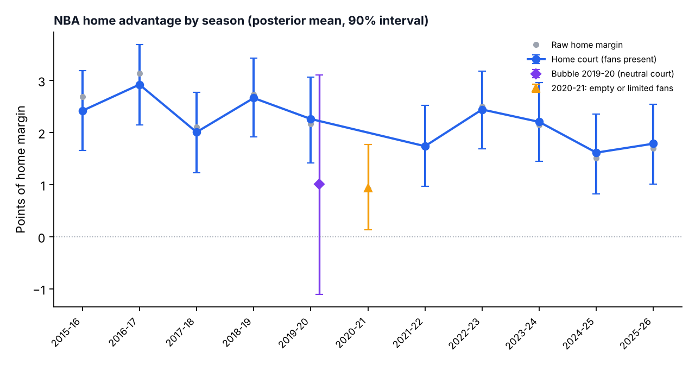
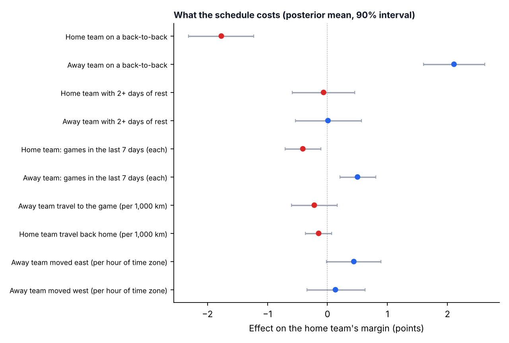
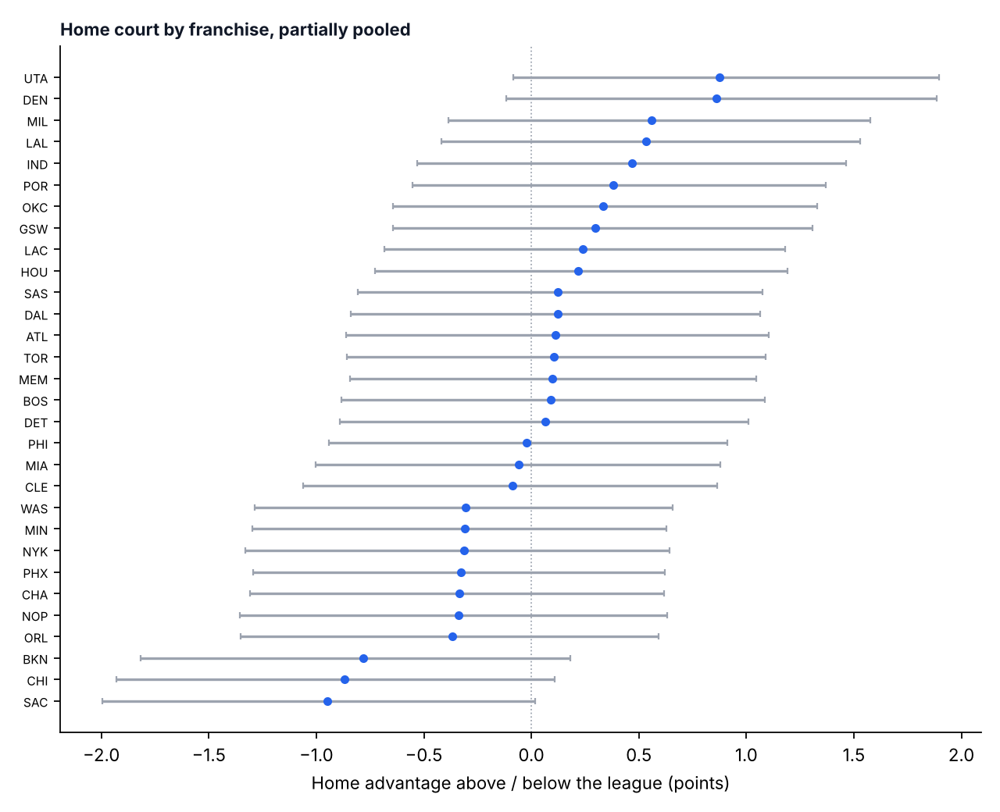

# What the schedule costs in the NBA (2015-16 → 2025-26)

**Question.** How many points of margin are explained by the schedule (back-to-backs, rest, game
density, travel, time zones) and by home court, once team strength is accounted for? And how much
of home court is the crowd?

**Data.** 13,077 regular-season games, 2015-16 to 2025-26, from this warehouse: margins from the
rebuilt box scores (only games whose rebuilt score matches the official one) and the schedule
context of both teams (`warehouse/context.py`: rest days, back-to-backs, games in the last 7 days,
great-circle travel between venues, time-zone shift and direction, crowd situation, neutral sites).

**Model.** A Bayesian hierarchical linear model of the home margin, fitted with a blocked Gibbs
sampler written in numpy (`schedule_effects.py`, all conjugate, 4,000 draws):

- home advantage with fans, one per season; a separate home advantage for the 2019-20 bubble
  (neutral courts) and for 2020-21 (empty arenas or limited fans);
- a random home-court effect per franchise (partially pooled: arenas with unusual records are
  pulled towards the league);
- a random strength per team-season (home strength minus away strength);
- the schedule terms of both teams, as fixed effects.

```bash
python -m analysis.schedule_effects                    # writes analysis/out/nba/
python -m analysis.schedule_effects --league wnba      # the same model for the WNBA
```

## Results



- **Home court is worth about 2.2 points with fans** (1.6 to 2.9 depending on the season). It is a
  little smaller in the last five seasons (2.0 on average) than in the first five (2.5).
- **About half of it is the crowd.** In 2020-21, with arenas empty or with limited fans, home court
  was worth 0.9 points (90% interval 0.1 to 1.8), roughly 1.3 points less than in a normal season.
  In the 2019-20 bubble the designated home team had no clear edge (1.0, from −1.1 to 3.1).



- **A back-to-back costs about 2 points** (home team −1.8, away team −2.1). With the game-to-game
  spread of the NBA (13 points), that is about 5 to 6 points of win probability in an even game.
- **Density matters on top of back-to-backs:** each extra game in the previous 7 days costs about
  0.4 to 0.5 points.
- **Extra rest beyond one day adds nothing measurable** (two or more days vs one: about 0).
- **Distance travelled has no clear effect** once back-to-backs and density are in the model.
- **Direction does:** an away team that moved east loses about 0.4 points per hour of time zone
  (probability 0.94 that the effect is real); moving west costs little or nothing.



- **Denver and Utah have the largest home advantage** (about 0.9 points above the league each,
  probability ~0.93): the two altitude arenas. Sacramento, Chicago and Brooklyn have the smallest.

## Validation

The model was fitted on the first 75% of each season and predicted the last 25% (3,273 games), next
to the same model without the schedule and crowd terms:

| Model | MAE | RMSE | Brier | Log loss | Accuracy |
|---|---|---|---|---|---|
| Team strength + home court | 10.86 | 13.80 | 0.214 | 0.617 | 66.2% |
| + schedule and crowd | 10.85 | 13.78 | 0.213 | 0.616 | 66.5% |

The schedule improves every metric, but by little: most of a game is team strength and noise. The
value is in the decisions where the schedule is the variable that can be managed (rest days,
load management, travel plans), not in predicting the winner.

## Limits

- Effects are associations adjusted for team-season strength; teams also choose when to rest players,
  so part of the back-to-back cost may be who sits, not fatigue. A player-availability term is the
  next step.
- 2020-21 is treated as one crowd situation; venue-by-date attendance would separate empty and
  partly full arenas.
- Rest is capped at three days and the first game of each season counts as rested.

Data: NBA Stats (through `nba_api`). Code: MIT. Author: Álvaro Bustamante-Sánchez, PhD.
